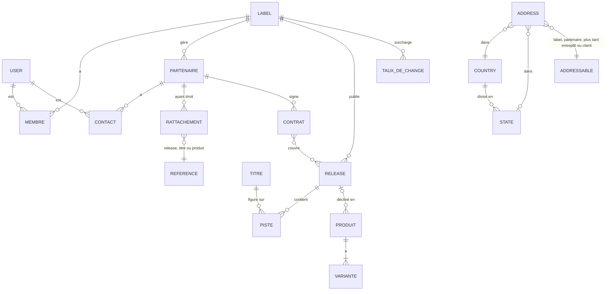

# Spécifications fonctionnelles – MVP

| | |
|---|---|
| Version | 0.4 – 31 octobre 2026 (brouillon à valider) |
| Périmètre | Lot 0 (socle SaaS, devises) et Lot 1 (catalogue, portail partenaires) |
| Référence | [Note de cadrage v1.4](cadrage.md) |
| Suivi | Epics [#2 Socle](https://github.com/cpuchalver/my-label-manager/issues/2) · [#3 Catalogue](https://github.com/cpuchalver/my-label-manager/issues/3) · [#8 Portail](https://github.com/cpuchalver/my-label-manager/issues/8) |

## 1. Objet

Ce document décrit ce que le MVP doit faire, assez précisément pour être découpé en issues et testé. Il couvre :

- le **socle SaaS** : labels isolés, utilisateurs, rôles, invitations, devises et taux de change, journal d'audit ;
- le **catalogue** : partenaires, releases, titres, produits et variantes, rattachement des partenaires, import CSV ;
- les **contrats** (documents PDF) et le **portail partenaires** : consultation des références et des contrats.

Hors MVP (rappel) : ventes et connecteurs (Lot 2), clauses de contrat, calcul et publication des relevés (Lot 3), stock (Lot 4), abonnements et inscription libre-service (Lot 5). Pas de reprise d'historique.

## 2. Acteurs et espaces

| Espace | URL | Utilisateurs | Isolation (tenant Filament) |
|---|---|---|---|
| Application label | `/app` | Équipe du label | Le **label** |
| Portail partenaires | `/portail` | Contacts des partenaires (artistes, labels, distributeurs) | Le **partenaire** |
| Console plateforme | `/admin` | Éditeur de la plateforme | Aucune (vue globale) |

- Un **compte utilisateur unique** par adresse e-mail. Un même compte peut être membre de plusieurs labels et contact de plusieurs partenaires (un artiste signé sur deux labels clients voit ses deux fiches dans le portail).
- L'accès à chaque espace est déterminé par les rattachements du compte : appartenance à un label pour `/app`, contact d'un partenaire pour `/portail`, drapeau administrateur plateforme pour `/admin`.
- Dans le portail, un sélecteur permet de passer d'un partenaire à l'autre ; chaque entrée affiche le partenaire et le label concerné (« Artiste X – chez Label Y »).

## 3. Rôles et droits

### Application label

| Action | Propriétaire | Administrateur | Gestionnaire | Lecteur |
|---|:-:|:-:|:-:|:-:|
| Consulter le catalogue, les partenaires, les contrats | ✓ | ✓ | ✓ | ✓ |
| Créer, modifier le catalogue et les partenaires | ✓ | ✓ | ✓ | |
| Importer un fichier CSV | ✓ | ✓ | ✓ | |
| Supprimer une référence ou un partenaire | ✓ | ✓ | | |
| Déposer et publier un contrat | ✓ | ✓ | | |
| Inviter un partenaire sur le portail | ✓ | ✓ | | |
| Gérer les membres et leurs rôles | ✓ | ✓ (sauf propriétaire) | | |
| Paramètres du label, taux de change manuels | ✓ | ✓ | | |
| Consulter le journal d'audit | ✓ | ✓ | | |
| Transférer la propriété, fermer le label | ✓ | | | |

Un label a toujours exactement un propriétaire.

### Portail partenaires

Un seul rôle, **contact**, en lecture seule : il consulte les références et les contrats publiés du partenaire auquel il est rattaché, et modifie uniquement son propre profil (nom, mot de passe, langue).

### Console plateforme

L'**administrateur plateforme** crée et suspend les labels, invite leur propriétaire, suit l'import des taux de change. Il n'accède pas au contenu des labels depuis la console ; pour le support, il peut **se connecter à la place d'un utilisateur** (impersonation, A4), sous conditions strictes.

## 4. Modèle de données

Toutes les tables métier portent un `label_id` et sont filtrées automatiquement sur le label courant.

### Socle

| Entité | Champs principaux | Règles |
|---|---|---|
| **Label** | nom, slug, pays (Country), devise de référence, fuseau horaire, langue par défaut (anglais si non précisé), logo, statut (actif, suspendu) | La devise de référence ne peut plus changer une fois des montants saisis (Lot 2 et suivants) ; en MVP elle reste modifiable. |
| **Utilisateur** | nom, e-mail (unique), mot de passe, langue, double authentification, administrateur plateforme (oui/non) | |
| **Membre** | label, utilisateur, rôle | Un utilisateur a un seul rôle par label. |
| **Invitation** | e-mail, type (membre ou contact), rôle ou partenaire cible, jeton, expiration, acceptée le | Valable 7 jours, usage unique, renvoyable. Si l'e-mail a déjà un compte, l'invitation rattache ce compte. |
| **Journal d'audit** | date, utilisateur, label, action, objet, valeurs avant et après | Voir RG-12. |

### Référentiel géographique

| Entité (code) | Champs principaux | Règles |
|---|---|---|
| **Pays** (`Country`) | code ISO 3166-1 alpha-2 et alpha-3, code numérique, nom (traduit), devise usuelle, indicatif téléphonique, subdivision obligatoire dans une adresse (oui/non), format de code postal (facultatif), actif | Référentiel commun à toute la plateforme, chargé depuis un jeu de données ISO (source et licence à valider). Non modifiable par les labels ; géré depuis la console (A5). |
| **Subdivision** (`State`) | pays, code ISO 3166-2 (ex. `US-CA`, `CA-QC`), nom (traduit), type (État, province, région, territoire…), active | Chargée pour les pays où elle sert dans une adresse postale (États-Unis, Canada, Australie, Brésil, Mexique, Inde, Italie, Espagne, Japon…). |
| **Adresse** (`Address`, polymorphe) | objet adressable (type et identifiant), type (principale, facturation, livraison, autre), libellé, destinataire, société, ligne 1, ligne 2, code postal, ville, subdivision, pays, par défaut (oui/non) | Rattachable à tout modèle « adressable » : au MVP le **label** et le **partenaire** ; plus tard l'entrepôt (Lot 4) et le client (ventes). Plusieurs adresses par objet, une seule par défaut pour chaque type. Voir RG-16. |

Le pays d'un label ou d'un partenaire est celui de son adresse principale ; les champs « adresse » et « pays » isolés disparaissent au profit de ce modèle commun.

### Devises

| Entité | Champs principaux | Règles |
|---|---|---|
| **Devise** | code ISO 4217, nom, nombre de décimales | Liste fournie par la plateforme. |
| **Devises actives du label** | label, devise | La devise de référence est toujours active. Seules les devises actives sont proposées dans les formulaires. |
| **Taux de change** | date, devise, taux contre l'euro, source (BCE ou manuel), label (vide pour un taux plateforme) | Un taux par devise, par date et par label ; voir RG-07 à RG-10. |
| **Montant** (objet valeur, pas une table) | valeur décimale exacte, code devise | Utilisé pour chaque montant de l'application. |

### Catalogue

| Entité | Champs principaux | Règles |
|---|---|---|
| **Partenaire** | type (artiste, label, distributeur), nom d'usage, raison sociale, e-mail, téléphone, adresses (Address), devise de relevé, n° de TVA, notes | La devise de relevé fait partie des devises actives du label. Pas de coordonnées bancaires au MVP (Lot 3). |
| **Contact** | partenaire, utilisateur | Un partenaire peut avoir plusieurs contacts. |
| **Release** | titre, artiste affiché, type (album, EP, single, compilation), numéro de catalogue, date de sortie, statut (en préparation, sortie, retirée), visuel, notes | Numéro de catalogue unique dans le label. |
| **Titre** | titre, version (ex. « Radio Edit »), ISRC, durée, artiste affiché | ISRC unique dans le label, format contrôlé (RG-04). Un titre peut figurer sur plusieurs releases. |
| **Piste** | release, titre, disque ou face, position | Ordonne la tracklist d'une release. |
| **Produit** | release (facultative), type (vinyle, CD, cassette, numérique, merch, autre), nom | Le merch peut exister sans release. |
| **Variante** | produit, libellé (ex. « Vinyle rouge 180 g », « T-shirt M »), SKU, UPC/EAN, prix de vente conseillé (montant), statut (actif, épuisé, arrêté) | Chaque produit a au moins une variante. SKU unique dans le label ; UPC/EAN unique dans le label et contrôlé (RG-04). La variante est l'unité qui sera rapprochée des ventes au Lot 2. |
| **Rattachement** | partenaire, référence (release, titre ou produit), rôle (artiste principal, artiste invité, label propriétaire, distributeur, producteur, autre) | Voir RG-05. Les parts et les taux viendront avec les contrats au Lot 3. |
| **Contrat** | partenaire, intitulé, type (royalties artiste, licence, distribution, dépôt-vente, autre), date de début, date de fin (facultative), releases couvertes, fichier PDF, statut (brouillon, publié, archivé), publié le | Seul un contrat publié est visible dans le portail. |

## 5. Fonctionnalités

Chaque fonction est accompagnée de ses critères d'acceptation, qui servent de base aux tests automatisés.

### 5.1 Console plateforme

**A1 – Gérer les labels.** L'administrateur crée un label (nom, pays, devise de référence, fuseau), le suspend ou le réactive.
- Un label suspendu n'est plus accessible à ses membres ni à ses partenaires ; ils voient un message explicite.
- La liste affiche le nombre de membres, de partenaires et de références de chaque label.

**A2 – Inviter le propriétaire.** À la création, l'administrateur saisit l'e-mail du propriétaire, qui reçoit une invitation.

**A3 – Suivre les taux de change.** Un écran montre la date du dernier import BCE, son statut et les devises couvertes ; un bouton relance l'import.

**A4 – Se connecter à la place d'un utilisateur (impersonation).** Depuis la console, l'administrateur choisit un label puis un membre, ou un partenaire puis un contact, et ouvre une session en son nom pour reproduire ce qu'il voit (RG-15).
- Un motif est obligatoire avant de démarrer (ex. « ticket support : import CSV en erreur »).
- Pendant toute la session, un bandeau visible sur chaque page indique « Connecté en tant que … » avec un bouton « Revenir à mon compte ».
- La session s'arrête automatiquement au bout de 30 minutes ou à la déconnexion, et l'administrateur retrouve sa propre session dans la console.
- Le démarrage et la fin apparaissent dans le journal d'audit du label concerné, consultable par son propriétaire et ses administrateurs, et dans le journal de la plateforme.

**A5 – Gérer le référentiel géographique.** L'administrateur consulte les pays et subdivisions, active ou désactive une entrée, corrige un nom ou une règle (subdivision obligatoire, format de code postal). Le référentiel peut être rechargé depuis la source sans écraser ces réglages.

### 5.2 Application label – socle

**L1 – Connexion et compte.** Connexion par e-mail et mot de passe, mot de passe oublié, double authentification facultative (recommandée pour propriétaire et administrateurs), choix de la langue.

**L2 – Changer de label.** Un utilisateur membre de plusieurs labels passe de l'un à l'autre par un sélecteur ; il arrive sur le dernier label utilisé.

**L3 – Gérer les membres.** Inviter par e-mail avec un rôle, changer un rôle, retirer un membre, renvoyer ou annuler une invitation.
- Le propriétaire ne peut pas être retiré ; il peut transférer la propriété à un administrateur.
- Un membre retiré perd l'accès immédiatement.

**L4 – Paramètres du label.** Nom, logo, pays, fuseau, langue par défaut, devise de référence, devises actives.
- Une devise ne peut pas être désactivée si un partenaire ou une variante l'utilise.

**L5 – Taux de change.** Consulter les taux du jour et leur historique pour les devises actives ; saisir un taux manuel pour une date, qui prend le pas sur le taux BCE pour ce label ; voir une alerte pour toute devise active sans taux récent (RG-09).

**L6 – Journal d'audit.** Liste filtrable par date, utilisateur et type d'objet, avec le détail des valeurs avant et après.

### 5.3 Application label – catalogue

**C1 – Partenaires.** Liste filtrable par type et par pays, fiche détaillée avec onglets : informations, adresses, références rattachées, contrats, contacts du portail.
- Le formulaire d'adresse est un composant commun réutilisé partout : le choix du pays filtre la liste des subdivisions et adapte les champs obligatoires.
- Un partenaire rattaché à des références ou des contrats ne peut pas être supprimé ; il peut être archivé.

**C2 – Releases.** Liste avec visuel, numéro de catalogue, artiste, type, date, statut ; fiche avec tracklist, produits et partenaires rattachés.
- Ajout d'une piste à partir d'un titre existant ou création du titre à la volée.
- Réordonnancement de la tracklist par glisser-déposer.

**C3 – Titres.** Liste et fiche ; la fiche indique les releases sur lesquelles le titre figure.

**C4 – Produits et variantes.** Création d'un produit depuis une release (formats) ou de façon autonome (merch), avec ses variantes.
- Le prix conseillé se saisit dans une devise active ; sa contre-valeur dans la devise de référence s'affiche au taux du jour, à titre indicatif.

**C5 – Rattacher des partenaires.** Depuis une release, un titre ou un produit, ajouter un ou plusieurs partenaires avec leur rôle.
- Un partenaire rattaché à une release est considéré comme rattaché à ses titres et à ses produits, sauf rattachement explicite différent (RG-05).

**C6 – Importer le catalogue (CSV).** Quatre modèles téléchargeables : partenaires, releases, titres et pistes, produits et variantes.
- Le fichier est contrôlé ligne par ligne ; un rapport téléchargeable liste les erreurs, les lignes valides sont importées.
- Une ligne dont l'identifiant (numéro de catalogue, ISRC, SKU) existe déjà met à jour la référence au lieu de la dupliquer : un import peut être relancé sans risque.
- Les imports s'exécutent en arrière-plan ; l'utilisateur est notifié à la fin.

**C7 – Recherche.** La recherche globale trouve une référence par titre, artiste, numéro de catalogue, ISRC, UPC/EAN ou SKU.

**C8 – Tableau de bord.** Compteurs (releases, titres, variantes, partenaires, contacts actifs sur le portail) et liste des références incomplètes : release sans UPC, titre sans ISRC, référence sans partenaire rattaché.

### 5.4 Application label – contrats et accès au portail

**K1 – Déposer un contrat.** Sur la fiche d'un partenaire : intitulé, type, dates, releases couvertes, fichier PDF. Le contrat est créé en brouillon.

**K2 – Publier un contrat.** La publication le rend visible dans le portail et envoie un e-mail aux contacts du partenaire.
- Le fichier d'un contrat publié ne peut plus être remplacé : pour corriger, on archive et on publie un nouveau contrat.
- L'archivage retire le contrat du portail sans le supprimer.

**K3 – Inviter un contact.** Depuis la fiche d'un partenaire, inviter une ou plusieurs adresses e-mail ; voir pour chaque contact sa dernière connexion ; retirer un contact.

### 5.5 Portail partenaires

**P1 – Accéder au portail.** Le contact accepte l'invitation, choisit son mot de passe (ou utilise son compte existant), se connecte, réinitialise son mot de passe.

**P2 – Choisir le partenaire.** Si le contact est rattaché à plusieurs partenaires, il choisit lequel consulter ; l'en-tête rappelle le partenaire et le label en cours.

**P3 – Mes références.** Liste des releases, titres et produits rattachés au partenaire (y compris par héritage), en lecture seule, avec visuel, date, numéro de catalogue, ISRC, UPC/EAN.
- Aucune information interne n'apparaît : notes internes, autres partenaires rattachés et leurs rôles, prix.

**P4 – Mes contrats.** Liste des contrats publiés avec téléchargement du PDF ; un indicateur signale les contrats non encore consultés.

**P5 – Mon profil.** Nom, langue, mot de passe, double authentification. Les coordonnées du partenaire sont affichées en lecture ; une modification se demande au label.

**P6 – Notifications.** Un e-mail à chaque contrat publié, avec un lien direct vers le portail. Aucun contenu du contrat dans l'e-mail.

## 6. Règles de gestion

| N° | Règle |
|---|---|
| RG-01 | **Cloisonnement des labels** : aucune donnée d'un label n'est lisible ni modifiable depuis un autre label, y compris par URL directe, recherche, import ou export. |
| RG-02 | **Cloisonnement des partenaires** : un contact ne voit que les données du partenaire sélectionné, et uniquement ce que le portail expose (P3, P4). |
| RG-03 | **Unicité** dans un label : numéro de catalogue (release), ISRC (titre), SKU et UPC/EAN (variante). Comparaison insensible à la casse, aux espaces et aux tirets. |
| RG-04 | **Formats** : ISRC sur 12 caractères (pays 2, déclarant 3, année 2, numéro 5) ; UPC sur 12 chiffres ou EAN sur 13 chiffres avec clé de contrôle vérifiée. Les identifiants sont enregistrés sans séparateurs et affichés au format usuel. |
| RG-05 | **Héritage des rattachements** : release → ses titres et ses produits. Un rattachement direct sur un titre ou un produit s'ajoute à ceux hérités ; l'héritage peut être désactivé référence par référence. |
| RG-06 | **Montants** : valeur décimale exacte (jamais en virgule flottante) avec un code devise ; arrondi selon le nombre de décimales de la devise, uniquement à l'affichage et au moment d'une conversion enregistrée. |
| RG-07 | **Source des taux** : import quotidien des taux de référence de la BCE (publiés les jours ouvrés vers 16 h, heure de Paris), stockés contre l'euro. Les devises non couvertes par la BCE se gèrent par saisie manuelle. |
| RG-08 | **Choix du taux** pour une devise et une date : taux manuel du label à cette date, sinon taux BCE à cette date, sinon dernier taux disponible dans les 7 jours précédents (week-ends, jours fériés). Les conversions entre deux devises autres que l'euro passent par l'euro. |
| RG-09 | **Taux manquant** : au-delà de 7 jours sans taux, la conversion est refusée avec un message explicite et une alerte est affichée au label ; aucune valeur par défaut n'est inventée. |
| RG-10 | **Taux figé** : toute conversion enregistrée conserve le taux, sa date et sa source ; une correction ultérieure des taux ne la modifie pas. En MVP, les conversions sont seulement affichées (C4) ; les premières conversions enregistrées arrivent avec les ventes au Lot 2. |
| RG-11 | **Suppression** : les références et partenaires utilisés ailleurs ne sont pas supprimables, seulement archivables ; les suppressions possibles sont réversibles 30 jours (corbeille). |
| RG-12 | **Audit** : sont journalisés les connexions, invitations, changements de rôle, modifications du catalogue et des partenaires, publications et archivages de contrats, taux manuels, imports, sessions d'impersonation. Toute action faite pendant une impersonation est attribuée à l'utilisateur concerné **et** à l'administrateur qui l'a réalisée. Le journal n'est pas modifiable. |
| RG-13 | **Fichiers** : PDF uniquement pour les contrats, 20 Mo maximum ; images JPG, PNG ou WebP pour les visuels, 10 Mo maximum. Stockage privé ; téléchargement par lien signé valable 5 minutes, après contrôle des droits. |
| RG-14 | **Dates** : stockées en UTC, affichées dans le fuseau du label (application) ou de l'utilisateur (portail). |
| RG-15 | **Impersonation** : réservée aux administrateurs plateforme ; impossible sur un autre administrateur plateforme ou sur un label suspendu ; impossible d'en démarrer une seconde en cours de session. Pendant l'impersonation sont interdits : changer mot de passe, e-mail ou double authentification, gérer les membres et leurs rôles, transférer la propriété ou fermer le label. Les droits sont ceux de l'utilisateur emprunté, jamais plus. Les conditions générales informent les labels de cette possibilité. |
| RG-16 | **Adresses** : pays obligatoire ; subdivision obligatoire si le pays l'exige, et forcément rattachée à ce pays ; code postal contrôlé quand le pays a un format connu ; noms de pays et de subdivisions affichés dans la langue de l'utilisateur, codes ISO stockés. Une adresse utilisée par un document émis (plus tard : relevé, facture) est copiée dans ce document pour qu'il ne change pas si l'adresse est modifiée. |

## 7. Exigences non fonctionnelles

- **Sécurité** : chaque ressource Filament protégée par une policy ; limitation des tentatives de connexion ; jetons d'invitation à usage unique ; en-têtes de sécurité HTTP ; dépendances surveillées.
- **Tests** : Pest pour chaque critère d'acceptation ; une suite de **tests de cloisonnement** qui tente, pour chaque ressource, l'accès depuis un autre label et depuis un autre partenaire ; tests unitaires des règles RG-03 à RG-10. PHPStan niveau 8 et Pint bloquants en CI.
- **Performance** : listes et fiches affichées en moins d'une seconde pour un catalogue de 5 000 variantes ; import de 5 000 lignes en moins de 5 minutes.
- **Données personnelles (RGPD)** : hébergement dans l'Union européenne ; export et suppression des données d'un contact à sa demande ; registre des traitements et mentions d'information sur le portail.
- **Exploitation** : environnements de recette et de production ; sauvegarde quotidienne de la base et des fichiers conservée 30 jours, restauration testée avant la mise en service ; suivi des erreurs et des tâches planifiées (import des taux).
- **Langues** : application en **anglais par défaut** (interface, e-mails, modèles CSV, PDF générés plus tard). Tous les textes passent par les fichiers de traduction Laravel, aucun texte en dur ; chaque utilisateur peut choisir sa langue parmi celles disponibles, et chaque label définit la langue par défaut de ses invitations. Le code, la base de données et les identifiants techniques sont en anglais.
- **Navigateurs** : deux dernières versions de Chrome, Firefox, Safari et Edge ; portail utilisable sur mobile.

## 8. Découpage proposé

Estimations en heures de développement, tests compris ; une marge de 20 % est à ajouter pour les imprévus.

### Lot 0 – Socle (epic #2) : environ 84 h

| Issue | Contenu | Estimation |
|---|---|---|
| S1 | Initialisation du projet, qualité (Pest, PHPStan, Pint), CI | 6 h |
| S2 | Hébergement, recette et production, sauvegardes, suivi des erreurs | 6 h |
| S3 | Labels et multi-tenancy de `/app`, socle des tests de cloisonnement (RG-01) | 10 h |
| S4 | Comptes, connexion, double authentification, rôles et policies, membres (L1 à L3) | 10 h |
| S5 | Invitations membres et contacts | 8 h |
| S6 | Panels `/portail` et `/admin`, règles d'accès, console des labels (A1, A2) | 6 h |
| S7 | Montants, devises, paramètres du label (L4, RG-06) | 8 h |
| S8 | Taux de change : import BCE, saisie manuelle, choix du taux, alertes (L5, A3, RG-07 à RG-10) | 12 h |
| S9 | Journal d'audit (L6, RG-12) | 4 h |
| S10 | Impersonation depuis la console (A4, RG-15) | 6 h |
| S11 | Référentiel pays et subdivisions (chargement, console A5), adresses polymorphes et composant de formulaire (RG-16) | 8 h |

### Lot 1 – Catalogue et portail (epics #3 et #8) : environ 120 h

| Issue | Contenu | Estimation |
|---|---|---|
| C1 | Partenaires et contacts | 10 h |
| C2 | Releases et tracklist | 10 h |
| C3 | Titres, contrôles ISRC | 8 h |
| C4 | Produits et variantes, contrôles UPC/EAN et SKU | 10 h |
| C5 | Rattachement des partenaires et héritage (RG-05) | 8 h |
| C6 | Import CSV du catalogue | 14 h |
| C7 | Recherche globale et tableau de bord | 6 h |
| K1 | Contrats : dépôt, publication, archivage, invitation des contacts | 10 h |
| P1 | Portail : accès, choix du partenaire, profil | 8 h |
| P2 | Portail : mes références | 8 h |
| P3 | Portail : mes contrats, téléchargement sécurisé, notifications | 8 h |
| P4 | Tests de cloisonnement du portail (RG-02) | 6 h |
| R1 | Recette sur le label pilote, saisie du catalogue actif, mise en production | 14 h |

Avec la marge, le Lot 1 représente environ 145 h, soit 6 semaines à 25 h : cohérent avec la fin janvier 2027 visée.

## 9. Points à valider

1. **Langues** : l'anglais est la langue par défaut (décidé). Une traduction française est-elle livrée dès le MVP (environ 6 h) ou plus tard ?
2. **Création des labels** : au MVP, c'est l'administrateur plateforme (toi) qui crée chaque label et invite son propriétaire. D'accord ?
3. **Coordonnées bancaires** : pas stockées avant le Lot 3, pour limiter les données sensibles au MVP. D'accord ?
4. **Coordonnées du partenaire** : modifiables uniquement par le label (le contact les voit en lecture et demande une correction), ou modifiables par le contact lui-même ?
5. **Héritage des rattachements** (RG-05) : un artiste rattaché à une release voit-il automatiquement tous ses titres et produits dans le portail, y compris les titres d'autres artistes sur une compilation ? Proposition : oui pour les albums, EP et singles ; non pour les compilations, où seul le rattachement par titre compte.
